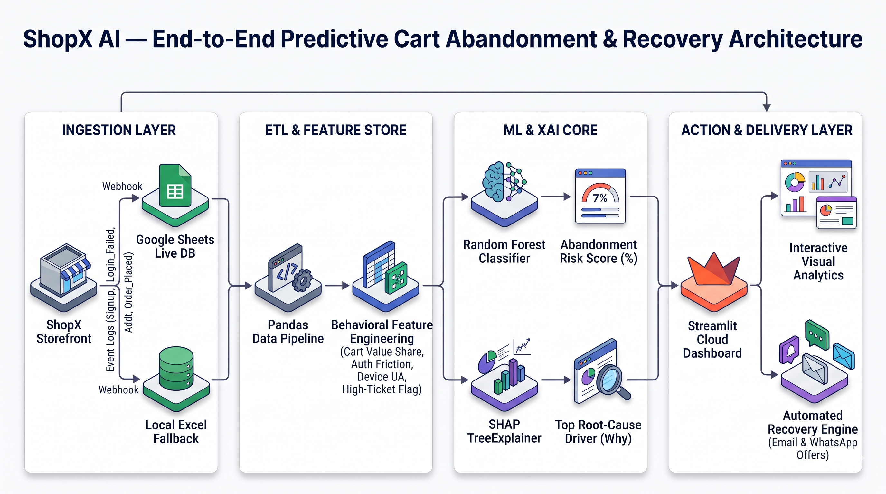

# 🛒 ShopX AI — Cart Abandonment Root-Cause Analyzer & Recovery Engine

An end-to-end **Predictive Machine Learning + Explainable AI (XAI)** analytics pipeline that connects directly to live e-commerce event logs stored in Google Sheets, predicts cart abandonment risk, identifies the exact mathematical reason ("Why") behind every dropped cart using **SHAP**, and generates personalized customer recovery campaigns.

---

## 🎯 Problem Statement & Objective
In e-commerce, over 70–85% of users add products to their cart and leave without completing the purchase. Traditional dashboards only show *how many* users left—not *why* an individual user abandoned a specific product. 

**ShopX AI** solves this by:
1. **Ingesting Live Behavioral Logs** (`SIGNUP`, `LOGIN_FAILED`, `ADD_TO_CART`, `ORDER_PLACED`) automatically synced from the ShopX web storefront to Google Sheets.
2. **Engineering Session & Friction Features** (cart value concentration, high-ticket item thresholds, pre-checkout authentication failures, mobile vs. desktop friction, and browsing hour).
3. **Explaining Drop-Off Drivers via SHAP** (`TreeExplainer`) at the individual user-item level.
4. **Automating Cart Recovery** by mapping each user's primary SHAP driver to a tailored recovery strategy (e.g., No-Cost EMI nudges, Bundle Discounts, or 1-Click Guest Checkout links) with pre-filled Email & WhatsApp dispatch.

---

## 🏗️ System Architecture

